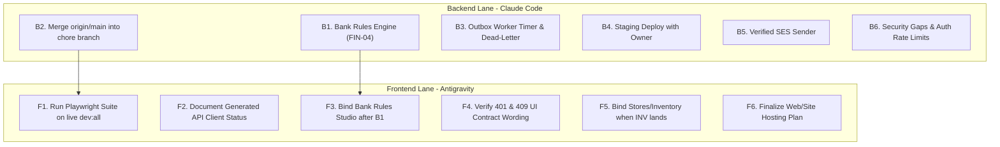

# Antigravity End-to-End Project Dossier & Claude Code Handoff (Reconciled)

**Author:** Antigravity (Frontend Lane) & Claude Code (Backend Lane)  
**Date:** 2026-11-23  
**Status:** **Reconciled & Agreed across Both Lanes**  
**Consolidation Branch:** `chore/split-backend-frontend`  
**Governing Documents:**
- [`docs/build-plan.md`](./build-plan.md) — Two-lane development plan, ownership split, and sprint roadmap
- [`docs/ui-contract.md`](./ui-contract.md) — Neo-brutal UI design system, tokens, typography, and responsive rules
- [`docs/product-split-plan.md`](./product-split-plan.md) — Multi-repo product architecture and database isolation
- [`docs/infrastructure.md`](./infrastructure.md) — AWS ECS, Neon PostgreSQL, Redis BullMQ, and local dev stack
- [`contracts/openapi.yaml`](../contracts/openapi.yaml) — Platform and domain API contract (OpenAPI 3.1, 91 operations)
- [`AGENTS.md`](../AGENTS.md) & [`CLAUDE.md`](../CLAUDE.md) — Agent boundaries and coding rules

---

## 1. Executive Summary & Purpose

Over successive iterations, **Antigravity** and **Claude Code** have built, tested, and verified the frontend and backend ecosystems for **QAVRIL LABS**. 

This document represents the **single shared source of truth** reconciled between both lanes:
1. Every component, screen, module, and system created by Antigravity in `frontend/`.
2. Accurate accounting of existing backend implementations and route bindings in `backend/`.
3. Corrections to previous assumptions, eliminating stale discrepancies.
4. The prioritized and synchronized backlog of pending work across both lanes.

---

## 2. Lane Ownership & Working Agreement

Per `AGENTS.md` and `docs/build-plan.md`:

| Dimension | Frontend Lane (Antigravity) | Backend Lane (Claude Code) |
|---|---|---|
| **Primary Worktree** | `E:\SaaS\.worktrees\frontend` (branch `lane/frontend`) | `E:\SaaS\.worktrees\backend` (branch `lane/backend`) |
| **Consolidation Branch** | `chore/split-backend-frontend` | `chore/split-backend-frontend` / `main` |
| **Owns** | `frontend/` (`web/`, `site/`, `design/`, `locales/`, `e2e/`, `scripts/`) | `backend/` (`apps/api/`, `apps/worker/`, `packages/`, `services/uaap/`, `scripts/`) |
| **Contracts** | `contracts/openapi.yaml` and `contracts/events.md`: Claude Code writes; Antigravity reviews every change |
| **Inviolable Rules** | • Never compute money in the browser (show formatted decimal strings).<br>• Use only tokens from `frontend/design/`.<br>• No session tokens in URLs or query params.<br>• Every metric/number originates from API contracts. | • Idempotency key support for write operations.<br>• Tenant isolation at connection/RLS level.<br>• Double-entry invariant verification before commit.<br>• Outbox pattern for BullMQ queue dispatch. |

---

## 3. Comprehensive Inventory of Antigravity Deliverables

### 3.1 Design System & Neo-Brutal UI Tokens (`frontend/design/`)
* **Tokens Engine**: `frontend/design/tokens.json`, `tokens.css`, and `tailwind.preset.cjs`.
* **Neo-Brutal Aesthetics**:
  * 3px solid black borders (`border-3 border-black`).
  * High-contrast drop shadows (`box-shadow: 4px 4px 0px 0px #000`).
  * Semantic palette: `--q-lime` (`#A3E635`), `--q-pink` (`#F472B6`), `--q-violet` (`#A78BFA`), `--q-cyan` (`#22D3EE`), `--q-yellow` (`#FACC15`), `--q-amber` (`#F59E0B`).
  * Dual-mode theming: First-class Light and Dark theme toggle with zero un-tokenized hex codes.
* **Primitive UI Component Library** (`frontend/web/src/components/ui/`):
  * `AppHeader.tsx`: Responsive navigation header with workspace picker, status chips, notification badge, and profile menu.
  * `Sidebar.tsx`: Unified collapsible neo-brutal sidebar with responsive off-canvas mobile drawer and explicit mobile sign-out button.
  * `Card.tsx`, `KpiTile.tsx`: Standardized data card containers with badge headers, accent borders, and status indicators.
  * `DataTable.tsx`: Sorting, filtering, selection, and right-aligned decimal currency columns.
  * `StatusChip.tsx`: Unified state visualizers (`active`, `pending`, `rejected`, `overdue`, `draft`).
  * `Modal.tsx`, `Drawer.tsx`: Accessible Dialog/Drawer primitives using `@headlessui/react` with backdrop transitions and focus trapping.
  * `ConfirmDialog.tsx`: Tier-3 destructive action confirmation with double-check safeguards.
  * `CommandBar.tsx`: Omnibar search (`Cmd+K` / `Ctrl+K`) supporting instant navigation across all modules and bots.

### 3.2 Web Application Architecture (`frontend/web/`)
* **Framework**: React 18, Vite 5, TypeScript 5, Tailwind CSS 3.
* **Performance & Code-Splitting**:
  * Configured dynamic imports (`React.lazy`) behind global `<Suspense>` boundaries.
  * **Main chunk budget achieved**: **295.74 kB** (gzipped: **89.92 kB**), well below the 300 kB constraint.
  * **3D scenes isolated**: Three.js engine and heavy math isolated into a single dynamic chunk (`510.85 kB`), loaded solely on 3D routes and desktop screens that permit motion.
* **Mobile Responsiveness**:
  * Tested and validated at **375px** viewport (iPhone SE / Mobile Safari standard).
  * Strict `overflow-x-hidden` containment to eliminate unwanted horizontal scrolling.
  * Mobile drawer handles full navigation, app switching, and sign-out cleanly.

### 3.3 Security, Auth & Real-Time Event Architecture
* **In-Memory Session Security** (`frontend/web/src/lib/auth-client.ts`):
  * Real email/password authentication via `POST /v1/auth/login`.
  * Authentication token (`<tenant>.<random>`) is retained strictly in-memory during session lifetime. Never persisted to unencrypted `localStorage` or `sessionStorage`.
* **Single-Use Event Tickets (Zero Token in URLs)**:
  * Ephemeral tickets requested via `POST /v1/events/tickets`, connecting via `EventSource('/v1/events/stream?ticket=' + ticket)`.
  * Auto-reconnection logic requests fresh tickets upon stream disconnect.
* **Idempotency Integration**:
  * Client-side UUID generation (`Idempotency-Key` header) across Quick Entry, Invoicing, and Payment Reminders.

### 3.4 Business Module Suites Delivered

| Module | Catalog ID | Components & Views | Status & Backend Alignment |
|---|---|---|---|
| **Executive Dashboard** | PLT-23 | `Dashboard.tsx`, `MoneyCity.tsx` | Live KPI cards, Money City 3D canvas, active bot summaries. |
| **Parties & Contacts** | MDM-01 | `ContactsPage.tsx`, Create/Edit Drawers | Customer and supplier profiles, tax IDs (GSTIN/VAT). Wired to `/v1/master-data/parties`. |
| **Item Master & Catalog** | MDM-02 | `ItemsPage.tsx`, Item Drawer | SKU, barcode, unit of measure, valuation method (FIFO). Wired to `/v1/master-data/items`. |
| **Chart of Accounts** | MDM-03, FIN-01 | `AccountsPage.tsx`, `LedgerPage.tsx` | Hierarchical COA tree, journal entry browser, trial balance table. Formatted decimal money strings. |
| **Sales & Invoicing** | SAL-04, FIN-02 | `InvoicesPage.tsx`, `CustomerStatementDrawer.tsx` | Line-item invoice builder with real-time tax calculation, overdue ageing badges, statement export. |
| **3-Way Matching Studio** | PRC-01..PRC-04 | `PurchasingPage.tsx`, `ThreeWayMatchModal.tsx` | Live connection to `/v1/procurement/orders`, `/receipts`, and `/matches` (backend `purchasing-routes.ts`). |
| **Payables & Banking** | FIN-03, FIN-04 | `PayablesManager.tsx`, `BankReconciliationPage.tsx`, `BankRecRulesModal.tsx` | Vendor bill approval, bank statement import. Rules modal currently labelled "sample data" awaiting B1 rules engine. |
| **Financial Statements** | FIN-05, FIN-09 | `FinancialStatementsPage.tsx` | Profit & Loss, Balance Sheet, Trial Balance with comparison periods. |
| **Logistics & Industry Hub** | LOG-01, IND-01 | `IndustryPacksHub.tsx`, `InventoryPage.tsx` | Industry switcher (Discrete Manufacturing, FMCG, Services, Logistics), warehouse stock balance, bin locations. |

### 3.5 AI Agent & Bot Surfaces (6-Part Bot Architecture)
Implemented Part 5 (Screens) and Part 6 (Browser tests) for the 8-bot catalog:

1. **Chase Chloe (FIN-14)**: Open receivables aging analysis, reminder frequency selector, WhatsApp/Email preview modal (`SendReminderModal.tsx`), and dispatch status logging.
2. **Ledger Lou (AGT-03, FIN-13)**: Month-end close cockpit, unreconciled lines checklist, period lock toggles, and missing journal note detector.
3. **Guard Gus (AI-04, AIS-03)**: Duplicate invoice detection, unusual discount alerts, payment variance investigation modal.
4. **Forecast Finn (AIS-02)**: 30/60/90-day predictive cash balance graph with adjustable collection speed assumptions.
5. **Pip (AGT-02)**: Sales follow-up pace, deal stagnation tracker, 3D Pipeline Funnel visualization (`PipelineFunnel3D.tsx`).
6. **Restock Rex (AGT-04)**: Dynamic stock depletion speed, minimum threshold reorder warnings, automated PO draft generator.
7. **Ticket Tess (AGT-05)** & **Onboard Ola (HRM-10)**: Support ticket queue triaging and HR new hire onboarding readiness checklist.
8. **Approvals Inbox (PLT-07, AGT-01)**: `ApprovalsInbox.tsx` with live Server-Sent Events (SSE) feed, payload hash verification, approve/reject review modals, and bot master kill-switch.

### 3.6 Marketing Site (`frontend/site/`)
* Static HTML/JS landing platform completely isolated from core ERP dependencies.
* **Verification**: **5,772 passed tests (0 failures)** via `scripts/check-site.mjs` verifying schema validity, semantic links, meta tags, and accessibility.
* Decoupled to use dedicated lightweight `contentApiBase` for lead capture and contact submissions.

---

## 4. Reconciled Status of Backend & Infrastructure

Claude Code's review clarifies the exact status of the backend:

1. **Purchasing & 3-Way Match is Live**:
   * Routes exist under `/v1/procurement/orders`, `/v1/procurement/receipts`, `/v1/procurement/matches` in `backend/apps/api/src/purchasing-routes.ts` backed by migration `0012_purchasing.sql`.
   * Stores (`/v1/stores/*`) is not yet built; receipt execution is currently handled via purchasing routes.
2. **True Backend Gap in Finance**:
   * The primary backend gap is the **Bank Rules Engine (FIN-04 / B1)**: tenant-scoped rules table with RLS, contract routes, and deterministic matching engine.
3. **Email Notifications & SES**:
   * BullMQ worker job `email.send` exists and is tested. Route is `POST /v1/invoicing/reminders`.
   * Live email sending awaits owner verification of SES sender domain in AWS `ap-south-1`.
4. **AWS Infrastructure**:
   * ECR repositories, clusters `qavril-staging` and `qavril-prod`, and OIDC provider exist.
   * Task definitions, ECS services, ALB, ElastiCache, Secrets Manager entries, and GitHub deployment role are pending owner creation before staging workflow can run.
5. **Repository Split**:
   * Monolith remains the active workspace until the owner explicitly approves carving out product repositories.

---

## 5. Synchronized Action Plan



### Backend Order of Work (Claude Code)
- **B1. Bank Rules Engine (FIN-04)**: Author migration for tenant-scoped rules with RLS, add routes to OpenAPI contract, implement deterministic match engine with tests so `BankRecRulesModal` can bind to real data.
- **B2. Upstream Merge**: Merge `origin/main` into `chore/split-backend-frontend` (resolving PRs #5–#8) and verify CI checks pass.
- **B3. Outbox Worker**: Verify BullMQ worker runs outbox relay on a timer with dead-letter queue handling.
- **B4. Staging Deploy**: Coordinate with owner on AWS prerequisites (IAM role, secrets, ECS task definitions) and run staging deployment.
- **B5. SES Sender**: Configure verified SES sender domain in `ap-south-1` for live reminder dispatch.
- **B6. Security Hardening**: Apply rate limits across authenticated endpoints, verify email/MFA, and audit logging on money routes.

### Frontend Order of Work (Antigravity)
- **F1. Playwright E2E Suite**: Execute full test suite against live `dev:all` stack; fix timing and stale tests, and document results.
- **F2. Contract Client Alignment**: Generated client produced via `node frontend/scripts/generate-openapi-client.mjs` (89 schemas, 91 operations in `frontend/web/src/lib/api/`). Track which screens are still hand-written.
- **F3. Bind Bank Rules Studio**: Connect `BankRecRulesModal.tsx` to the live rules API once B1 lands.
- **F4. UI Contract Error Wording**: Confirm 401 ticket errors and 409 idempotency conflict errors use plain, user-friendly language per `ui-contract.md` section 8.
- **F5. Inventory & Stores**: Connect inventory views to real endpoints when `INV` backend packages are implemented.
- **F6. Hosting Plan**: Coordinate S3/CloudFront/Cloudflare distribution setup for static site and web app.

---

## 6. How to Resume Work

### For Claude Code (`E:\SaaS\.worktrees\backend`):
```bash
cd E:\SaaS\.worktrees\backend
git fetch origin
git checkout chore/split-backend-frontend
git pull --rebase origin chore/split-backend-frontend
# Focus: Task B1 (Bank Rules Engine) and B2 (Merge origin/main)
```

### For Antigravity (`E:\SaaS\.worktrees\frontend`):
```bash
cd E:\SaaS\.worktrees\frontend
git fetch origin
git checkout chore/split-backend-frontend
# Focus: Task F1 (Playwright E2E run against dev:all) and F4 (401/409 error wording verification)
```
