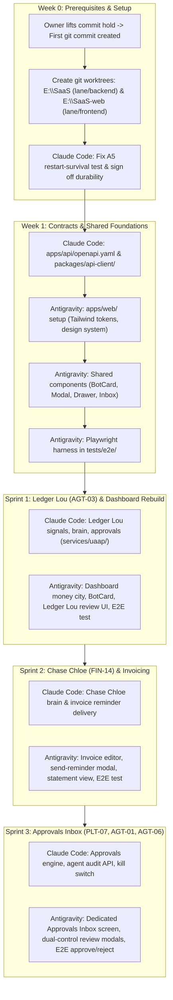

# Unified Bot Build Plan: Split by Part (Claude Code & Antigravity)

**Date:** 2026-11-11  
**Status:** Agreed Alignment Baseline  
**Governing Documents:** [docs/build-plan.md](../build-plan.md), [docs/ui-contract.md](../ui-contract.md), [CLAUDE.md](../../CLAUDE.md), [AGENTS.md](../../AGENTS.md)

---

## 1. Agreement on the Bot Architecture Split

Antigravity and Claude Code agree: **split every bot by part, not the list of bots by half.**

This aligns 100% with `docs/build-plan.md` and the hard rules in `AGENTS.md` ("*Never touch packages/, apps/api/, services/uaap/, migrations or authentication. You are the frontend lane*").

### The 6-Part Division of Responsibility

| Part | Description | Owner | Primary Paths |
|---|---|---|---|
| **1. Signals** | Read API endpoints in Core SaaS delivering exact figures | **Claude Code** | `apps/api/`, `packages/*` |
| **2. Brain** | Agent/bot logic, guardrails, model prompts, and tool calls | **Claude Code** | `services/uaap/` |
| **3. Action & Approval** | Tool commands, limits, proposal drafts, inbox records, audit log, kill switch | **Claude Code** | `apps/api/`, `services/uaap/` |
| **4. Delivery** | Message templates (email, WhatsApp, in-app alerts) | **Claude Code** | `services/uaap/`, `packages/*` |
| **5. Screens** | `BotCard`, Bot Configuration/Detail Page, Approvals Inbox with review modals, enable/disable toggle, charts/3D visualization | **Antigravity** | `apps/web/` |
| **6. Tests** | Backend unit evaluations with known data (Claude Code); Playwright E2E browser tests of signal, draft, review modal, and outcome (Antigravity) | **Both** | `services/uaap/tests/` (Claude Code) `tests/e2e/` (Antigravity) |

---

## 2. Why This Split Eliminates All Blockers

1. **Zero Folder Overlap:**  
   - Claude Code writes exclusively in `services/uaap/`, `packages/*`, and `apps/api/`.  
   - Antigravity writes exclusively in `apps/web/`, `site/`, `design/`, `locales/`, and `tests/e2e/`.  
   - Antigravity never touches `services/uaap/`.
2. **Solves Wave 1 Data & Platform Dependencies:**  
   - Claude Code builds the necessary Core SaaS APIs and adapters (e.g. leads HTTP API, document parser integration, inbox notifications) in proper dependency order without violating ADR-004.
3. **Complete Vertical Slices:**  
   - Every bot ships as a functional pair: backend brain and signal API + frontend UI and E2E browser tests.

---

## 3. Dependency Roadmap & Execution Order

---

## 4. Bot Rollout Order (Sprint by Sprint)

Following the critical path in `docs/build-plan.md`:

| Sprint | Bot | Claude Code Delivers (Parts 1–4, 6a) | Antigravity Delivers (Parts 5, 6b) |
|---|---|---|---|
| **Sprint 1** | **Ledger Lou** (AGT-03, FIN-13) | Trial balance & reconciliation signals, month-end checklist brain, unit evals | Rebuilt dashboard, `BotCard`, checklist drawer, E2E month-end test |
| **Sprint 2** | **Chase Chloe** (FIN-14) | Overdue invoice signals, reminder message drafts, delivery integration | Invoice editor, send-reminder modal, customer statement, E2E reminder test |
| **Sprint 3** | **Approvals Platform** (PLT-07, AGT-01, AGT-06) | Durable approval engine, inbox endpoints, kill switch (`POST /v1/admin/agents/{id}/disable`) | Dedicated Approvals Inbox screen, hash verification modal, agent toggle UI |
| **Sprint 4** | **Restock Rex** (AGT-04) & **Guard Gus** (AI-04) | Reorder point signals, PO drafts, anomaly detection brain | Stock screens, PO approval drawer, warehouse 3D scene, anomaly alert chip |
| **Sprint 5** | **Forecast Finn** (AIS-02) & **Pip** (AGT-02) | Cash forecast calculations, quiet deal follow-up drafts | Cash river 3D scene, forecast trend charts, sales pipeline funnel |
| **Sprint 6+** | **Industry Pack Bots** (GAR/FMCG) | Pack SDK, costing/regulatory agents (GAR08, FMCG12, etc.) | Pack screens, CommandBar chat interface, marketing pages |

---

## 5. Prerequisite Checklist Before Coding

- [ ] **Owner Action:** Lift the hold on repository commits so the first commit can be created.
- [ ] **Claude Code Action:**
  1. Commit initial state to `main`.
  2. Create branch `lane/backend` in `E:\SaaS`.
  3. Create branch `lane/frontend` and worktree `E:\SaaS-web`.
  4. Fix A5 restart-survival test (`test_restart_survival.py`) and sign off durability.
  5. Rewrite `docs/ai-agent-readiness/BOT_BUILD_SPLIT.md` to reflect the by-part agreement.
- [ ] **Antigravity Action:**
  1. Switch workspace context to `E:\SaaS-web` on branch `lane/frontend`.
  2. Initialize `apps/web/` foundations using `design/` tokens and preset.
