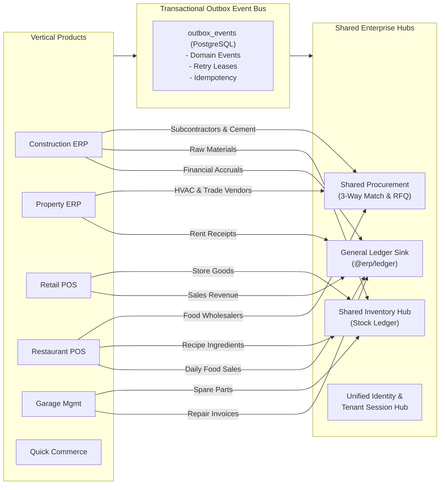

# QAVRIL LABS — Cross-Product Integration & Data Flow Matrix

**Document ID:** QAVRIL-INT-006  
**Author:** Principal Enterprise Systems Architect  
**Date:** November 5, 2026  
**Status:** Multi-Product Integration & Interoperability Specification  

---

## 1. Enterprise Integration Architecture

In a multi-product enterprise suite, applications must communicate through **standardized contracts** rather than direct database writes. QAVRIL LABS enforces three integration patterns:
1. **Synchronous REST APIs:** For user-driven queries and instantaneous validation (e.g. checking customer credit limit).
2. **Transactional Outbox Event Bus:** For state-changing business actions that must trigger downstream reactions (e.g. sales invoice posted -> General Ledger journal posted).
3. **UAAP Universal Agent Orchestration:** For cross-product reasoning, approvals, and data synthesis.



---

## 2. Product-to-Shared-Module Cross Matrix

| Product Name | General Ledger Sink (`@erp/ledger`) | Shared Inventory Hub (`stock_ledger`) | Shared Procurement (`procurement`) | Shared Identity & RBAC (`@erp/identity`) | Outbox Event Integration (`@erp/events`) | UAAP Agent Orchestration |
|---|---|---|---|---|---|---|
| **Construction ERP** | **Yes** (Contractor RA bills, material issues post to Cost Ledger) | **Yes** (Store inventory, material issues, gate passes) | **Yes** (3-way PO matching, RFQs, vendor evaluations) | Planned (currently Express RBAC) | Planned (bridge to Outbox) | **Active** (Zyno Copilot) |
| **Property Management** | **Yes** (Rent receipts, PDC settlements, security deposits) | Partial (maintenance equipment and supplies) | **Yes** (Trade category vendors, repair purchase orders) | Supabase Auth (JWT) | pg_cron + SQL triggers | Planned (UAAP) |
| **Retail POS** | **Yes** (Daily end-of-shift register sales, cash drawer variances) | **Yes** (Store stock levels, barcode items, stock transfers) | **Yes** (Central supplier replenishment orders) | Fastify Session Tokens | Planned (Outbox events) | Planned (UAAP) |
| **Restaurant POS** | **Yes** (Food sales, dining tips, beverage taxes, wastage write-offs)| **Yes** (Ingredient stock deduction via BOM recipes) | **Yes** (Perishable food wholesale purchasing) | Drizzle / Nitro auth | Planned (Outbox events) | Planned (UAAP) |
| **IT HelpDesk** | N/A (Internal cost center) | Partial (IT hardware and peripheral asset inventory) | **Yes** (Hardware purchase requisitions, license renewals) | Supabase Auth (JWT) | Ticket workflow events | Planned (UAAP) |
| **Procurement Management** | **Yes** (Committed costs, AP invoice matching, advance payments) | **Yes** (Reorder threshold checks against current stock) | **Core Engine** (RFQ comparison, vendor quotation scoring) | Fastify / PostgreSQL | Outbox events emitted | Planned (UAAP) |
| **Garage Management** | **Yes** (Customer service bills, labor revenue, parts margin) | **Yes** (Spare parts inventory, oil barrels, tires) | **Yes** (Auto parts wholesaler purchase orders) | Prisma session auth | Planned (Outbox events) | Planned (UAAP) |
| **Quick Commerce Delivery**| **Yes** (Driver payouts, delivery commission fees, COD cash ledger) | **Yes** (Dark store inventory tracking) | Partial (packaging supplies) | Supabase Auth (JWT) | Driver dispatch events | Planned (UAAP) |
| **Visitor Management** | N/A (Security operations) | N/A | Partial (badge paper, kiosk consumables) | Supabase Auth (JWT) | Access check-in events | Planned (UAAP) |
| **HIMS (Healthcare)** | **Yes** (Patient billing, pharmacy dispensing revenue, doctor payouts)| **Yes** (Pharmaceutical stock, surgical supplies, batch/expiry) | **Yes** (Medical equipment and medicine bulk purchases) | Supabase Auth (JWT) | Clinical audit events | Planned (UAAP) |
| **Business & SME ERP** | **Core Engine** (Chart of accounts, fiscal periods, balanced journals)| **Yes** (Multi-branch warehouse stock) | **Yes** (Integrated purchasing workflow) | **Core Engine** (scrypt, hashed sessions) | **Core Engine** (`outbox_events`) | Planned (UAAP) |

---

## 3. Standardized Event Contracts Across Repositories

When an application completes a business transaction, it writes an event to the outbox adhering to `@erp/events`:

```typescript
export interface DomainEvent<T = unknown> {
  readonly id: string;           // UUID v7
  readonly tenantId: string;     // Calling tenant UUID
  readonly type: string;         // e.g. "sales.invoice.posted", "construction.dpr.submitted"
  readonly aggregateId: string;  // e.g. Invoice ID or Project ID
  readonly payload: T;           // Validated JSON payload
  readonly occurredAt: string;   // ISO 8601 UTC timestamp
  readonly schemaVersion: number;// Schema contract version
}
```

### High-Frequency Cross-Product Events:
1. `sales.invoice.posted`: Emitted by Retail POS, Restaurant POS, Sales Management, or Property Leasing. Trigger: Automatically generates balanced journal entry in `packages/ledger`.
2. `inventory.item.depleted`: Emitted when ingredients are deducted for a restaurant order or cement is issued on a construction site. Trigger: Evaluates reorder threshold; drafts Purchase Order if below minimum.
3. `procurement.grn.received`: Emitted when goods arrive at a warehouse. Trigger: Initiates 3-way matching check against the original PO and vendor invoice.
4. `compliance.pdc.matured`: Emitted when a post-dated cheque reaches its due date. Trigger: Alerts cashier and queues deposit voucher.

