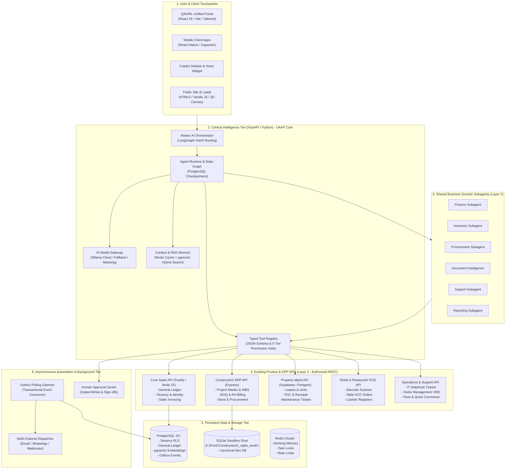

# QAVRIL LABS — Recommended Target Architecture for AI Agent Ecosystem (Expanded)

**Document ID:** QAVRIL-AUDIT-011-V2  
**Author:** Principal Enterprise ERP & AI Systems Architect  
**Date:** November 5, 2026  
**Status:** Architectural Blueprint & Target Topology for 39 Products  

---

## 1. Architectural Vision & Suitability Evaluation

The proposed future target architecture establishes a **Unified Intelligence Layer (UAAP)** that sits beside existing ERP applications without replacing them or requiring high-risk database rewrites:

---

## 2. Evaluation of Proposed Technologies Against Expanded Portfolio

| Target Technology | Suitability Evaluation | Interaction with 39-Product Workspace |
|---|---|---|
| **Modular Monolith** | **Ideal** | Perfectly aligns with `E:\SaaS` (`packages/*`). Domain packages remain isolated while sharing kernel utilities. |
| **React, TypeScript, Vite, Tailwind** | **Ideal** | Standard frontend framework used across PMS, Retail POS, IT HelpDesk, Garage Management, and Enterprise Copilot. |
| **FastAPI & Python for AI Services** | **Ideal** | Leverages proven LangGraph code in `E:\Port\Zyno Genie` and RAG pipelines in `E:\Port\Scrapper RAG`. |
| **PostgreSQL & pgvector** | **Ideal** | PostgreSQL with Row-Level Security is already the core database of `E:\SaaS`, `PMS`, `IT Helpdesk`, and `Restaurant POS`. Adding the `pgvector` extension natively provides tenant-isolated semantic search. |
| **Redis for Coordination** | **High** | Provides fast in-memory task locks, rate-limit counters, and active conversational scratchpads across multi-product agents. |
| **Dedicated Background Workers** | **Critical** | Solves the outbox event dispatch gap, bridging asynchronous business events between Construction, PMS, POS, and the General Ledger. |
| **LangGraph for Stateful Agents** | **Ideal** | Proven in `E:\Port\Zyno Genie` for multi-step agent graphs, state checkpointing, and human approval pause/resume. |
| **Centralized Model Gateway** | **Critical** | Replaces uncoordinated Axios and LangChain model calls with a unified, metered proxy targeting Ollama Cloud (`deepseek-v4.1-flash:cloud`, `gemma4:31b-cloud`, `glm-5.3-flash:cloud`, `minimax-m2.7:cloud`) with automatic provider failover. |

---

## 3. Strict Architectural Guardrails for Target Architecture

1. **Zero Database Bypassing:** AI agents must **never** receive raw database connection strings or execute arbitrary SQL. All reads and writes must pass through validated REST API endpoints with RBAC enforcement.
2. **Construction SQLite Containment:** The target architecture must respect the SQLite-only verification policy of Construction ERP (`E:\Port\Construction\_sqlite_work\`). The Express API acts as the sole authorized gateway to that data.
3. **Immutability of Financial Sinks:** General Ledger and audit trail records must remain append-only. The target architecture will prohibit any AI tool from issuing updates or deletes to financial entries.
4. **Tenant Isolation by Construction:** Every agent request, memory lookup, and tool invocation must be stamped with a validated `tenant_id`. Cross-tenant data leakage is structurally impossible under PostgreSQL RLS.
