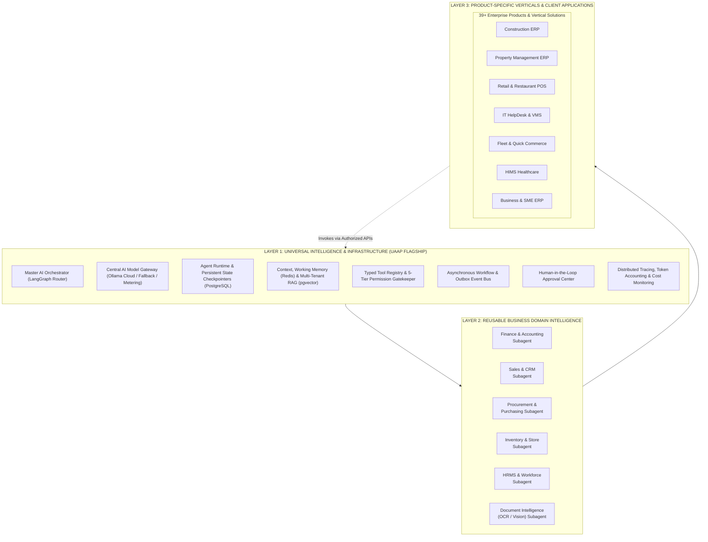

# QAVRIL LABS — Universal AI Agent Platform (UAAP) Target Architecture

**Document ID:** QAVRIL-ARCH-004  
**Author:** Principal AI Systems Architect & Enterprise Solutions Architect  
**Date:** November 5, 2026  
**Status:** Unified Three-Tier Architecture Specification  

---

## 1. The Three-Layer Architecture Philosophy

To achieve global enterprise scale without building dozens of redundant, uncoordinated chatbots, QAVRIL LABS structures its AI ecosystem into **Three Architectural Layers**:

---

## 2. Layer 1: Universal Intelligence (UAAP Core Platform)

The **Universal AI Agent Platform (UAAP)** is the centralized, multi-tenant intelligence backbone of QAVRIL LABS. It provides 8 universal capabilities shared by every product:

### 1. Master AI Orchestrator
- **Technology:** Python 3.11+ / FastAPI / LangGraph state graph.
- **Role:** Global intent classifier and task decomposition engine. It accepts natural language queries from any client interface (web, mobile, voice, API), identifies the user's intent and product context, and routes execution to the appropriate domain subagent.
- **Resilience:** Employs the supervisor pattern to monitor subagent execution steps, handle tool call errors, and aggregate multi-agent responses into a unified output.

### 2. Central AI Model Gateway
- **Preferred Providers:** Ollama Cloud (`deepseek-v4.1-flash:cloud`, `glm-5.3-flash:cloud`, `gemma4:31b-cloud`, `minimax-m2.7:cloud`) with commercial API fallback (Gemini, Claude, OpenAI).
- **Core Capabilities:**
  - *Dynamic Routing:* Selects the most cost-effective and capable model for each task (e.g. `deepseek-v4.1-flash` for code and math, `gemma4:31b` for structured JSON extraction).
  - *Automatic Failover:* Transparently cascades requests to secondary providers if the primary provider times out (120s timeout cap) or returns rate-limit errors.
  - *Token Accounting:* Real-time metering of input/output tokens logged against the calling tenant ID.
  - *Security Enforcement:* Blocks credentials from ever reaching client browsers; acts as an isolated server-side proxy.

### 3. Agent Runtime & Persistent State
- **State Engine:** LangGraph checkpointers backed by PostgreSQL tables (`agent_runs`, `agent_checkpoints`).
- **Resumability:** Workflows can pause indefinitely (e.g. awaiting multi-day manager approvals) and resume without losing conversational context or execution history.

### 4. Multi-Tiered Memory & RAG Infrastructure
- **Short-Term Scratchpad (Redis):** Caches active multi-turn conversational turns and intermediate tool outputs with automatic TTL expiration.
- **Long-Term Semantic Memory (PostgreSQL + pgvector):** Stores embeddings of corporate SOPs, product documentation, vendor contracts, and resolved tickets with strict tenant isolation (`tenant_id = current_setting('app.tenant_id')`).

### 5. Typed Tool Registry & 5-Tier Permission Gate
- **Tool Protocol:** Every tool exposes a strict JSON-Schema contract defining input parameters, output schemas, and security classification.
- **5-Tier Governance:**
  - *Tier 1 (Read-Only):* Automated execution (e.g. `get_project_budget`).
  - *Tier 2 (Draft):* Pre-fills documents with `is_ai_draft: true`.
  - *Tier 3 (Gated Write):* Requires human cryptographic approval (e.g. `create_purchase_order > $1,000`).
  - *Tier 4 (Authorized Write):* Standard automated write with audit logging (e.g. `log_site_dpr`).
  - *Tier 5 (Restricted):* Permanently blocked (raw SQL, schema alters).

### 6. Workflow Engine & Outbox Worker
- Continuously polls the PostgreSQL `outbox_events` table using atomic database leases (`locked_until`), converting business transactions into asynchronous agent triggers without blocking user HTTP requests.

### 7. Human-in-the-Loop Approval Center
- An omnichannel approval hub (in-app notification, email, WhatsApp) where supervisors can review, reject, or authorize Tier 3 agent actions with a single click.

### 8. Observability & Cost Monitoring
- OpenTelemetry distributed tracing recording prompt hashes, latencies, and tool call outcomes. Provides tenant-level dashboards tracking token spend and operational ROI.

---

## 3. Layer 2: Reusable Business Domain Intelligence

Rather than duplicating business logic in every product, Layer 2 encapsulates reusable domain agents:

| Domain Subagent | Reusable Capabilities | Shared Across Products |
|---|---|---|
| **Finance Agent** | Double-entry balancing, accounts reconciliation, P&L generation, tax compliance | Construction ERP, Property ERP, Retail POS, Restaurant POS, HIMS, SME ERP |
| **Sales Agent** | Invoicing, quotations, customer pricing tiers, commission calculation | Business ERP, Property Sales, POS Retail, Quick Commerce |
| **Procurement Agent** | Purchase requisitions, RFQ comparison, 3-way matching, vendor scoring | Construction ERP, Property ERP, IT HelpDesk, Production ERP, Garage |
| **Inventory Agent** | Stock ledger, replenishment thresholds, reorder lead times, scrap tracking | Retail POS, Restaurant POS, Construction Store, Garage, Production ERP |
| **HRMS Agent** | Leave policy Q&A, biometric attendance auditing, statutory payroll validation | Property ERP, Construction ERP, HIMS, Corporate Enterprise |
| **Document Intelligence** | Universal OCR, invoice data extraction, PDF contract analysis, vision defect checks | Every product across the QAVRIL LABS portfolio |

---

## 4. Layer 3: Product-Specific Verticals & Client Edge

Layer 3 provides specialized adapters and UI extensions that ground the shared intelligence in the specific operational realities of each product:
- **Construction ERP:** Bridges to `E:\Port\Construction\_sqlite_work\` via Express REST APIs. Enforces WBS/CBS invariants, BOQ caps, and site DPR image analysis.
- **Property Management ERP:** Bridges to Supabase PostgreSQL via custom RPCs. Enforces lease rent-free terms, PDC deposit state machines, and tenant portal security.
- **Retail & Restaurant POS:** Bridges to React Native mobile and local cache. Enforces rapid 30-second checkout, table split-billing, and KOT dispatching.
- **Third-Party Enterprise API:** Exposes UAAP as an intelligence-as-a-service platform for external enterprise systems.

