# HRMS End-to-End Design: Requisition to Exit

Status: **proposal for review.** Nothing in `ERP-Product-Catalog.md` or `backend/` has changed. New IDs in section 3 become real only after they are added to the catalog and `npm --prefix backend run catalog:generate` is run.

Scope: the full employee lifecycle, from a headcount request to the employee's exit and post-exit records, for one legal entity in one country at a time. Country specifics are configuration packs (CLAUDE.md rule 5), not code forks.

Sources: the HRM rows of `ERP-Product-Catalog.md` (HRM-01 to HRM-15), the dependency rows (PLT, MDM, FIN, PRC), `docs/industry-portfolio.md`, `docs/ai-agent-readiness/PRODUCT_TO_AGENT_MAPPING.md` section 13, and general HR practice. The HR-specific tabs of the reference process files were not reviewed for this draft. Items marked **Decision** need the owner's answer before build.

---

## 1. Ground rules

These come from CLAUDE.md and apply to every HRMS module.

1. **Tenant isolation.** Every HR table has `tenant_id` and row-level security. Access goes only through `withTenantTransaction`.
2. **Events, not direct writes.** HR publishes domain events through the outbox in the same transaction as the write. Payroll never writes ledger tables; it emits `PayrunPosted` and FIN-01 posts it.
3. **Effective dating.** Anything that changes over time (position, department, manager, salary, pay component, leave policy, statutory rule) is stored as a row with `valid_from` and `valid_to`. Changes insert a new row; they never overwrite history. A correction that touches a closed period is a reversal or an adjustment in the open period.
4. **Append-only where money or entitlement moves.** Leave balances, attendance punches, payroll lines, and loan schedules are ledgers. Corrections post reversing rows.
5. **Money.** Amounts are integer minor units in `@erp/money`, serialized as decimal strings. Leave is counted in half-day units (integers), not floats.
6. **Dates.** Business dates are `YYYY-MM-DD` in the branch's time zone. Punch timestamps are UTC ISO 8601, mapped to a business date using the branch time zone.
7. **Numbers.** Requisition, candidate, offer, employee code, payrun, exit case and settlement numbers come from `NumberingService` in the same transaction as the document.
8. **Errors.** `DomainError` with a code; the API maps codes to HTTP status.
9. **Personal data.** Employee and candidate data are classified (section 9). Sensitive fields are encrypted at rest and masked in lists. Every read of a sensitive field is audited.
10. **Definition of done** per module (CLAUDE.md rule 7): permissions, audit trail, import and export, reports, translatable strings, responsive UI, API documentation in `contracts/openapi.yaml`, tests. Money-moving code (payroll, F&F, loans, leave encashment) needs balance tests.

---

## 2. The lifecycle at a glance

```mermaid
flowchart LR
  A[Headcount plan] --> B[Requisition]
  B --> C[Sourcing and screening]
  C --> D[Interviews and scorecards]
  D --> E[Offer and approval]
  E -->|accepted| F[Pre-boarding]
  F --> G[Joining: employee active]
  G --> H[Probation]
  H -->|confirm| I[Employed: attendance, leave, pay, performance, learning]
  H -->|extend or end| X
  I -->|transfer, promotion, pay change| I
  I --> X[Separation initiated]
  X --> N[Notice period]
  N --> Y[Clearance and exit interview]
  Y --> Z[Full and final settlement]
  Z --> R[Separated: records kept, rehire flag]
  E -->|declined| C
```

Stages and owners:

| Stage | What happens | Main owner | Ends when |
|---|---|---|---|
| Plan | Positions, budget, approved headcount | HR and finance | Position is approved and funded |
| Requisition | Hiring request for a position | Hiring manager | Requisition is approved and open |
| Recruit | Candidates, screening, interviews, scorecards | Recruiter and hiring panel | Candidate is selected |
| Offer | Offer letter, pay check, approval, acceptance | Recruiter, HR, approver | Offer accepted |
| Onboard | Documents, equipment, access, induction | HR and IT | Employee has started and is set up |
| Probation | Trial period, review, confirmation | Manager and HR | Confirmed, extended, or ended |
| Employed | Time, leave, pay, benefits, performance, learning, changes | Employee, manager, payroll | Separation starts |
| Separate | Resignation or termination, notice, clearance, F&F | Manager, HR, payroll, finance | Settlement is paid and the record is closed |
| Post-exit | Alumni flag, rehire eligibility, retained records | HR | Retention period ends and records are purged |

---

## 3. Catalog mapping

### 3.1 Existing rows, with the scope this design expects

| ID | Name | Phase in catalog | Scope in this design |
|---|---|---|---|
| HRM-01 | Employee Records | P2 | Employee master, employment history, documents, custom fields |
| HRM-02 | Org Structure & Positions | P2 | Departments, positions, position control, reporting lines, cost centers |
| HRM-03 | Attendance & Time | P2 | Shifts, punches, exceptions, regularisation, overtime |
| HRM-04 | Leave Management | P2 | Leave types, policies, balance ledger, requests, encashment |
| HRM-05 | Payroll Engine | P2 | Pay structures, pay runs, payslips, bank files, ledger events |
| HRM-06 | Statutory Filings | P2 | Statutory rule packs and return files, one country at a time |
| HRM-07 | Employee Self-Service | P2 | Payslips, leave, regularisation, profile changes, documents |
| HRM-08 | Workforce Scheduling | P2 | Rotas and labour forecast (after HRM-03) |
| HRM-09 | Recruitment (ATS) | P3 | **Decision:** pull a minimal pipeline (requisition to offer) into P2 (section 10) |
| HRM-10 | Onboarding & Offboarding | P3 | Onboarding is here. Exit is split out (HRM-18) |
| HRM-11 | Performance Management | P3 | Goals, reviews, calibration |
| HRM-12 | Learning Management | P3 | Courses and compliance training |
| HRM-13 | Compensation & Benefits | P3 | Pay bands, salary revisions, benefits enrollment |
| HRM-14 | Compliance Expiries | P2 | Work permits, licences, certificates |
| HRM-15 | Engagement Surveys | P4 | Pulse surveys |

### 3.2 Proposed new rows

These fill gaps the lifecycle exposes. Each needs a catalog entry before work starts.

| Proposed ID | Name | Size | Phase | Depends on | Why |
|---|---|---|---|---|---|
| HRM-16 | Headcount Planning & Requisitions | S | P2 | HRM-02, PLT-07, FIN-08 | Hiring starts with an approved position and budget. Nothing in the catalog covers this. |
| HRM-17 | Employee Lifecycle Events | M | P2 | HRM-01, HRM-02, PLT-07 | Probation, confirmation, transfer, promotion, status changes, all effective-dated |
| HRM-18 | Separations, Clearance & Full and Final | M | P2 | HRM-17, HRM-05, HRM-04, FIN-04, PLT-07 | Exit is a process of its own; the catalog only mentions offboarding under HRM-10 |
| HRM-19 | Employee Loans & Advances | S | P2 | HRM-05, FIN-02 (receivable), FIN-01 | Loans affect payroll and must be settled at exit |

Adding HRM-16 to HRM-19 means the phase counts in `docs/process-flow-product-map.md` section 5 (product L) change. The map should be updated in the same change.

---

## 4. Module specifications

Each module has: purpose, data, rules, events, and the edge cases its tests must cover. Edge-case tests use the naming pattern `<module>_<situation>_<expected>`.

### 4.1 HRM-02 Org Structure & Positions

**Purpose.** A position is the seat; an employee holds a position. Headcount control and reporting lines hang off positions.

**Data.**
- `hrm_departments`: id, code, name, parent, cost center (FIN-08 dimension), `valid_from`, `valid_to`.
- `hrm_positions`: id, code, title, department, grade, reports-to position, approved headcount, budgeted annual cost (money), status (`open`, `filled`, `frozen`, `closed`), `valid_from`, `valid_to`.
- `hrm_position_assignments`: position, employee, fraction (for part-time or split roles, sums to 1 per position at any date), `valid_from`, `valid_to`.

**Rules.**
- Filled headcount never exceeds approved headcount on the position. Attempting it returns `CONFLICT`.
- Reporting lines must not form a cycle. Check on every change.
- Closing a department requires no active employees and no open positions in it.
- Cost-center changes apply to postings from the effective date. Earlier postings are not moved.

**Edge cases.**
- `org_reporting_cycle_rejected`: A reports to B, B reports to A → `VALIDATION`.
- `org_headcount_over_approved_conflict`: filling a frozen or full position → `CONFLICT`.
- `org_department_close_with_active_staff_blocked`.
- `org_cost_center_change_not_retroactive`.

### 4.2 HRM-16 Headcount Planning & Requisitions (new)

**Purpose.** Control who can be hired, for which position, with what budget.

**Data.**
- `hrm_headcount_plans`: period, department, position, planned headcount, budget (money), status (`draft`, `approved`, `locked`).
- `hrm_requisitions`: number (NumberingService), position, requested by, reason (`new`, `backfill`, `replacement`, `conversion`), target start date, priority, budgeted cost, status, approvals.
- `hrm_requisition_events`: append-only history.

**Requisition states.** `draft → submitted → approved → open → on_hold → filled → closed`; `submitted → rejected`; `draft → cancelled`; `open → cancelled` (only when no offer is out).

**Rules.**
- A requisition needs an open position with free approved headcount, or a backfill for an employee who has a separation date.
- Backfill needs the leaving employee's separation (HRM-18) to be at least in notice, or the requester states a reason. Otherwise the requisition needs the full approval path.
- Approval path (PLT-07): by budget band and department. Example bands are configuration, not code.
- Requisition is `filled` when the first offer is accepted. Headcount is reserved from `open`, so two requisitions cannot fill one position.
- A requisition left `open` past its target date raises a reminder (PLT-10), not an automatic close.

**Events.** `RequisitionApproved`, `RequisitionFilled`, `RequisitionClosed`.

**Edge cases.**
- `req_backfill_without_separation_needs_full_approval`.
- `req_two_requisitions_one_position_blocked`.
- `req_cancel_with_open_offer_blocked`.
- `req_budget_over_band_routes_higher_approver`.

### 4.3 HRM-09 Recruitment (candidate pipeline)

**Purpose.** Get from an open requisition to a selected candidate with a fair, recorded process.

**Data.**
- `hrm_candidates`: party link (MDM-01), contact, source, consent record, retention date. One candidate can apply to many requisitions.
- `hrm_applications`: candidate, requisition, stage, stage history, rejection reason code.
- `hrm_interviews`: application, round, panel, scheduled time, outcome.
- `hrm_scorecards`: application, interviewer, competency ratings (structured), notes, submitted at. Scorecards are locked once submitted.

**Stages.** `applied → screened → shortlisted → interviewing → selected → offer_stage`; any stage may move to `rejected` or `withdrawn` with a reason code.

**Rules.**
- Structured scorecards are required before a candidate moves past interview. Each panel member submits their own; they cannot see others' scores until they have submitted theirs (blind submission).
- Rejection needs a reason code from a fixed list. Rejection notices are templates (PLT-10).
- Protected attributes are not collected in the main candidate record. Optional diversity fields are stored separately, are not visible to hiring panels, and are used only in aggregate reports.
- **No automated rejection or ranking without a human decision.** Any AI-assisted screening (for example resume summaries) is advisory, records its reasoning, and never changes a stage by itself.
- Candidate data is kept for a configurable retention period (for example 6 months after the last activity) and then deleted or anonymized. A withdrawal request triggers earlier deletion.
- Duplicate candidates (same email or phone) are flagged for merge, not silently merged.

**Events.** `ApplicationStageChanged`, `CandidateSelected`, `CandidateRejected`.

**Edge cases.**
- `rec_scorecard_locked_after_submit`.
- `rec_panel_cannot_see_other_scores_before_submit`.
- `rec_stage_skip_blocked` (interview skipped without a waiver code).
- `rec_duplicate_candidate_flagged_not_merged`.
- `rec_retention_expiry_deletes_candidate_keeps_aggregate_counts`.

### 4.4 Offer and conversion to employee (part of HRM-09 and HRM-01)

**Purpose.** Make a legally clear offer, get it approved if it is off-band, and turn an accepted offer into an employee record for joining.

**Data.**
- `hrm_offers`: application, position, grade, proposed pay structure (references to pay components), proposed joining date, expiry date, template version, status, approvals, sent and accepted times, e-signature reference (PLT-11).
- Offer letter is generated from a versioned template (PLT-12 print engine).

**States.** `draft → pending_approval → approved → sent → accepted | declined | expired | withdrawn`. `approved` is returned to `draft` if the pay changes.

**Rules.**
- Offer pay is checked against the pay band for the grade (HRM-13). Within band: approved by the recruiter's manager. Outside band: approved by HR and finance (approval routing through PLT-07). Figures come from configuration; the system never computes a band itself from other figures.
- Offer expiry date is required. Acceptance after expiry → `CONFLICT`, not acceptance.
- Acceptance creates an employee in status `pre_boarding` (HRM-01) with the joining date, and fills the position (HRM-16).
- Declining returns the application to `interviewing`/`selected` per the recruiter's choice and reopens the requisition if no other candidate is selected.
- A withdrawn offer after acceptance (before joining) needs a reason code and triggers the same reopen rule.

**Events.** `OfferApproved`, `OfferSent`, `OfferAccepted`, `OfferDeclined`, `EmployeeCreatedFromOffer`.

**Edge cases.**
- `offer_accept_after_expiry_conflict`.
- `offer_pay_change_resets_approval`.
- `offer_outside_band_requires_hr_and_finance`.
- `offer_accepted_fills_position_once` (two concurrent accepts → one wins).

### 4.5 HRM-01 Employee Records

**Purpose.** The one record of a person's employment. A person (party, MDM-01) can have several employments over time (rehire, contract change).

**Data.**
- `hrm_employees`: id, employee code (NumberingService), party link, status (see 6.1), legal entity, branch, first joining date, date of birth (sensitive), gender (optional, sensitive), nationality, personal contact, emergency contact (sensitive).
- `hrm_employments`: employee, employment type (`permanent`, `fixed_term`, `contract`, `part_time`, `intern`), start, end (null if open), `valid_from`, `valid_to`. A rehire creates a new employment; the employee code can stay the same.
- `hrm_employee_documents`: links to PLT-11 with type, expiry date, verification status.
- Identity and bank fields: `hrm_employee_identity` (national ID type and number, tax ID, social security number), `hrm_employee_bank_accounts` (effective-dated). These are sensitive (section 9).

**Rules.**
- Employee code is unique per tenant and never reused, even after exit.
- Identity numbers are unique per country within a tenant. A duplicate on rehire links to the existing party, it does not create a second party.
- Changes to bank account details require a second person to verify (SoD, section 7). The new account is effective from the next pay run after verification.
- Editing a closed employment is not allowed; a correction creates an adjustment row with a reason.

**Events.** `EmployeeCreated`, `EmployeeUpdated`, `EmployeeStatusChanged`, `BankAccountChangeVerified`.

**Edge cases.**
- `emp_rehire_reuses_party_and_code`.
- `emp_duplicate_national_id_blocked`.
- `emp_bank_change_same_user_verify_blocked`.
- `emp_bank_change_effective_next_run_only`.

### 4.6 HRM-17 Employee Lifecycle Events (new)

**Purpose.** Every change to an employee's status, role or cost is a dated event with approval, so the history is complete and payroll and reports can read it.

**Event types.**
| Type | Effect | Approval |
|---|---|---|
| Probation review | Confirm, extend (new end date), or end (moves to separation, 4.9) | Manager, then HR |
| Confirmation | Employment type becomes permanent; probation ends | Manager, then HR |
| Transfer | Department, position, branch, or cost center changes from a date | Old manager, new manager, HR when branch or entity changes |
| Promotion or grade change | Position and grade change; pay change through HRM-13 | Manager, HR, and finance when pay changes |
| Role or title change | No pay change | Manager |
| Leave of absence (unpaid) | Status `on_leave`; accrual and attendance rules change | Manager, HR |
| Suspension | Status `suspended`; no pay change until decided | HR, with reason code |
| Return from leave or suspension | Status back to `active` | Manager |

**Rules.**
- Probation end date is set from the employment's policy (configuration; default in the country pack, for example 3 or 6 months) at joining. A task appears on the manager's list 14 days before the end date.
- If the probation review is not recorded by the end date, the employee is confirmed automatically only if the policy says so; otherwise the case escalates to HR. The default is escalation, not automatic confirmation.
- Transfers change the cost center for postings from the effective date. Payroll for periods before the effective date uses the old cost center.
- A status change that stops pay (unpaid leave, suspension) is applied from the first day of the next pay period unless HR sets an earlier date that falls within an open period, in which case payroll recalculates that period before approval.

**Events.** `EmployeeConfirmed`, `ProbationExtended`, `EmployeeTransferred`, `EmployeePromoted`, `EmployeeStatusChanged`.

**Edge cases.**
- `life_probation_end_without_review_escalates`.
- `life_transfer_mid_period_splits_cost_center_for_payroll`.
- `life_suspension_effective_before_closed_period_blocked`.
- `life_overlapping_position_assignments_sum_over_one_blocked`.

### 4.7 HRM-03 Attendance & Time

**Purpose.** Turn raw punches, shifts and requests into one daily record per employee, which payroll and leave read.

**Data.**
- `hrm_shifts`: code, start, end, break rules, grace minutes, night-shift flag, branch time zone.
- `hrm_shift_assignments`: employee, shift or rota, `valid_from`, `valid_to`.
- `hrm_punches`: append-only: employee, device or source (biometric device, mobile with geofence, web, manual entry), punch time (UTC), business date (branch time zone), raw reference. Duplicates from the same device within a configured window are dropped with a reason.
- `hrm_attendance_days`: employee, business date, status (`present`, `absent`, `half_day`, `on_leave`, `holiday`, `weekly_off`, `exception`), worked minutes, late minutes, early-leave minutes, overtime minutes, source punches, locked flag.
- `hrm_regularisations`: employee, date, requested change, reason, approval status.

**Daily logic.**
1. Gather punches for the business date. The first punch in is the start, the last punch out is the end, and punches inside the break window are subtracted.
2. Compare to the shift: late if start is after shift start plus grace; early if end is before shift end minus grace.
3. If the day is a holiday (MDM-05 holiday calendar) or weekly off, status comes from the calendar unless punches show work (then overtime rules apply).
4. If a leave request covers the date and is approved, status is `on_leave`, and punches do not change it.
5. Missing punch (odd count, or no out-punch) → `exception` until corrected or regularised.
6. Overtime is computed per the branch's overtime rule (configuration): daily threshold, weekly threshold, or both. Overtime is only counted after approval if the rule requires pre-approval.

**Rules.**
- Attendance days are locked when the payroll period that contains them is approved. Corrections after lock become adjustments that payroll picks up in the next period.
- Punch time and business date are both stored, so a punch near midnight or in a different time zone is attributed correctly.
- A manual entry needs a reason and is flagged in reports.

**Events.** `AttendanceDayClosed`, `AttendanceExceptionRaised`, `RegularisationApproved`.

**Edge cases.**
- `att_night_shift_punch_after_midnight_belongs_to_start_day`.
- `att_duplicate_device_punch_within_window_dropped`.
- `att_holiday_with_punches_uses_holiday_overtime_rule`.
- `att_leave_overrides_missing_punch`.
- `att_locked_day_correction_creates_adjustment_not_edit`.
- `att_dst_change_day_minutes_correct`.

### 4.8 HRM-04 Leave Management

**Purpose.** Entitlements are a ledger. Requests consume the ledger. Payroll reads the ledger for loss-of-pay and encashment.

**Data.**
- `hrm_leave_types`: code, name, paid or unpaid, unit (half-day, always), requires attachment, allows half day, counts toward sandwich rule (configuration).
- `hrm_leave_policies`: leave type, applicable grades or employment types, accrual rule (none, fixed annual, monthly accrual, per worked day), accrual amount in half-days, pro-rata for joiners, carry-forward cap, expiry (months after accrual), encashment allowed and cap, `valid_from`, `valid_to`. Effective-dated.
- `hrm_leave_ledger`: append-only: employee, leave type, date posted, quantity (half-day units, signed), reason (`accrual`, `usage`, `reversal`, `carry_forward`, `expiry`, `encashment`, `adjustment`), source reference.
- `hrm_leave_requests`: employee, type, from, to, half-day flags, reason, attachment, status, approvals.

**Request states.** `draft → submitted → approved | rejected`; `approved → cancelled` (before the leave starts, or after with approval); `approved → partially_cancelled` for a shorter stay.

**Rules.**
- A request is rejected if the balance is less than the requested quantity, unless the policy allows negative balance (then the excess is unpaid leave).
- Overlapping approved leave for the same employee is rejected.
- Requests across a weekly off or holiday count those days only if the leave type's sandwich rule says so.
- Approval routing (PLT-07): by days (for example up to 2 days, the manager; longer, the manager and HR). Auto-approval is allowed only where the policy says so.
- Balance is the sum of the ledger rows for the employee and type as of the date. Nothing stores a balance that the ledger cannot reproduce.
- **Accrual job** runs at the start of each period (scheduled job, PLT-06): posts accrual rows once per period per employee using the policy in force on that date. Joiners get pro-rata accrual from their joining date (rounded down to half-day).
- **Carry-forward** at year end: min(balance, cap) carried, the rest posts an `expiry` row. Carry-forward is idempotent per year (a unique key on employee, type, year).
- **Encashment** at exit or on request (policy): quantity capped; the value is calculated in HRM-18 and HRM-05, not here.
- **Leave liability** for finance: monthly, sum of encashable balance times daily rate per employee. This is an accrual posting (FIN-13 accruals), not part of the payroll run.

**Events.** `LeaveRequested`, `LeaveApproved`, `LeaveRejected`, `LeaveBalanceChanged`, `LeaveAccrued`, `LeaveExpired`.

**Edge cases.**
- `leave_insufficient_balance_rejected` (negative not allowed).
- `leave_overlap_rejected`.
- `leave_half_day_odd_units_exact` (half-day units are integers; 3 half-days = 1.5 days).
- `leave_sandwich_counts_weekend_only_when_policy_says`.
- `leave_joiner_prorata_rounds_down_to_half_day`.
- `leave_carry_forward_idempotent_per_year`.
- `leave_expiry_after_cap_posts_expiry_row`.
- `leave_cancel_after_start_needs_approval`.
- `leave_accrual_policy_change_mid_year_uses_date_in_force`.

### 4.9 HRM-18 Separations, Clearance & Full and Final (new)

**Purpose.** Run every exit the same way: notice, clearance, settlement, letters, access removal, and records.

#### 4.9.1 Exit types

| Type | Starts from | Notice | Settlement notes |
|---|---|---|---|
| Resignation | Employee request | Per contract or policy; shortfall is recoverable | Notice shortfall deducted; leave encashment per policy |
| Termination, performance | Manager request, HR approval | Per contract or statute | Statutory checklist before approval |
| Termination, misconduct | HR case | Often none | Statutory checklist; legal review flag; deductions capped per country |
| Redundancy | HR plan | Statutory notice and severance | Severance from country pack; consultation checklist |
| Contract end | Contract end date (auto-prompt 60 days before) | None | Renewal or end decision recorded |
| Retirement | Age or contract rule | Per policy | Gratuity or pension rules per country pack |
| Death in service | HR, with documents | None | Beneficiary payments; no employee self-service actions |
| Absconding | Unauthorised absence beyond N days (policy) | None | Notice to last known address per country rules; separation after the policy period |

#### 4.9.2 Exit flow

1. **Initiate.** Employee, manager, HR or the system creates an exit case with type, reason code, requested last working day, and notice terms (computed from the employment's notice policy).
2. **Approve.** Manager, then HR. Termination needs the statutory checklist to be complete before this step. Redundancy needs the consultation record.
3. **Notice period.** The case is in notice. Status `notice`. Employee self-service shows exit tasks. Notice can be shortened or bought out; each change is an approved event with the money effect computed for F&F.
4. **Access plan.** A scheduled task removes system access at the end of the last working day (branch time, 23:59 local), through identity (PLT-01) by event. Failed removal retries and alerts; it does not silently skip.
5. **Last working day.** Attendance and leave stop. Any open leave request is cancelled or converted to encashment per policy.
6. **Clearance.** Checklist items, each with an owner:
   - IT: equipment returned, accounts deactivated, mailbox and data handover.
   - Finance: outstanding advances, loans (HRM-19), expense claims (FIN-11), company credit cards.
   - Stores or operations: company property (keys, tools, uniforms) from the register.
   - Manager: handover of work and projects.
   - HR: exit interview recorded, documents (contract, certificates) issued.
   Each item is `pending`, `cleared`, or `waived` (waiver needs a reason and an approver). Clearance is complete only when every item is cleared or waived.
7. **Full and final (F&F).** Calculated per section 4.9.3. Reviewed by payroll, approved by finance and HR.
8. **Payment.** F&F runs as a special payrun (HRM-05) or an off-cycle payment through FIN-03/FIN-04. Posts `FnFPosted` to the ledger.
9. **Letters.** Relieving letter, experience letter, final payslip, and the statutory exit forms, from versioned templates (PLT-12).
10. **Close.** Employment `valid_to` is set. Employee status becomes `separated`. Rehire eligibility is recorded (`eligible`, `not_eligible`, `eligible_after_date`) with a reason.

#### 4.9.3 Full and final logic

Components are read from configuration (country pack) and from HRM-05, HRM-04 and HRM-19. The settlement is a list of lines, each with source and calculation id.

| Line | Calculation | Source |
|---|---|---|
| Salary for worked days in the final period | Monthly basic and fixed components × days worked ÷ days in period, rounded per the pay rounding rule | HRM-05, HRM-03 |
| Leave encashment | encashable half-days ÷ 2 × daily rate, capped per policy | HRM-04 |
| Notice pay or shortfall | Positive: notice not served and paid out (if the policy allows buy-out). Negative: (required notice − served) × daily rate, recovered | HRM-18 notice record |
| Bonus or incentive pro-rata | Per plan rules (configuration) | Plan data |
| Gratuity or end-of-service benefit | Per country pack formula, with service days from employments | Country pack |
| Severance | Per country pack or contract | Country pack |
| Reimbursements approved but unpaid | Sum of approved claims | FIN-11 |
| Less: loan balances | Outstanding principal and interest due | HRM-19 |
| Less: advances and recoveries | Outstanding advances, unreturned property value if policy allows | HRM-18 clearance |
| Less: statutory deductions | Per country pack; any cap on deductions from final pay is applied | Country pack |
| **Net payable** | Sum of lines, in minor units | |

**Rules.**
- Every line shows its formula input values and the rule version used.
- If net payable is negative, the balance is recorded as a receivable from the employee (FIN-02), not paid as a negative amount.
- Any figure that cannot be sourced (for example a missing gratuity formula in the pack) makes the settlement `BLOCKED`, with the missing input named. It is never estimated.
- A settlement cannot be paid until clearance is complete (or waivers approved) and the case is approved.
- A settlement is immutable once approved. A correction is a supplementary settlement that references the original.

**Events.** `ExitInitiated`, `ExitApproved`, `NoticeChanged`, `ClearanceCompleted`, `FnFCalculated`, `FnFApproved`, `FnFPaid`, `EmployeeSeparated`, `AccessRemovalScheduled`, `AccessRemoved`.

**Ledger effects.**
- `FnFApproved`: expense for salary, leave encashment, bonus and gratuity, with the liability to the employee; deductions reduce the liability; receivables recorded for loans and advances.
- `FnFPaid`: liability reduced by the bank payment (FIN-04 bank file).

**Edge cases.**
- `exit_resignation_shortfall_recovered_from_fnf`.
- `exit_termination_without_statutory_checklist_blocked`.
- `exit_clearance_pending_blocks_fnf_payment`.
- `exit_waiver_requires_approver_and_reason`.
- `exit_fnf_net_negative_becomes_receivable`.
- `exit_fnf_missing_gratuity_rule_blocked_not_estimated`.
- `exit_fnf_after_closed_payrun_uses_special_run`.
- `exit_rescinded_resignation_restores_employment_no_fnf`.
- `exit_death_no_self_service_beneficiary_path`.
- `exit_absconding_separation_only_after_policy_period`.
- `exit_access_removal_failure_retries_and_alerts`.
- `exit_fnf_paid_twice_blocked_by_idempotency_key`.

### 4.10 HRM-19 Employee Loans & Advances (new)

**Purpose.** Loans and salary advances are receivables, repaid through payroll and settled at exit.

**Data.**
- `hrm_loans`: employee, type (loan, advance), principal (money), interest rule (configuration), instalments, start month, status (`requested`, `approved`, `disbursed`, `repaying`, `closed`, `written_off`).
- `hrm_loan_schedule`: instalment rows, each with due period, principal part, interest part, status.

**Rules.**
- A loan is approved against a policy limit (multiple of pay or fixed cap). Above the limit: higher approval.
- Disbursement posts a receivable (FIN-02) and a bank payment (FIN-04).
- Each payrun deducts the due instalment, capped so net pay does not fall below the policy floor. If the cap bites, the unpaid part carries to the next period (no loss).
- Early repayment and exit settlement reduce principal first, then interest, per the rule.
- Interest is computed on the schedule with integer minor units; the last instalment absorbs rounding.

**Edge cases.**
- `loan_deduction_capped_carries_forward`.
- `loan_exit_settles_outstanding_from_fnf`.
- `loan_last_instalment_absorbs_rounding`.
- `loan_over_limit_routes_higher_approver`.
- `loan_disbursed_twice_blocked`.

### 4.11 HRM-05 Payroll Engine

**Purpose.** Calculate pay for a period from approved inputs, approve it, post it to the ledger, and pay it.

**Pay structure (effective-dated).**
- `hrm_pay_components`: code, name, type (`earning`, `deduction`, `employer_cost`), taxable flag, calculation (fixed amount, percent of another component, formula from the country pack), rounding rule, proration rule.
- `hrm_salary_structures`: employee, list of component assignments with amounts or formula inputs, `valid_from`, `valid_to`. A revision inserts a new structure row.

**Pay calendar.** Monthly by default (configuration). Each calendar has periods with start, end, pay date, and a cut-off date for inputs.

**Payrun states.**
`draft → calculated → verified → approved → posted → paid → closed`.
- `calculated → draft` on input change (recalculation).
- `verified → calculated` if any line changes.
- `approved` locks the lines. Posting and payment do not change lines.
- `paid → closed` after bank confirmation and reconciliation (FIN-04).
- `cancelled` is allowed from `draft` or `calculated` only. After posting, the run is reversed by a reversal run (never deleted).

**Calculation steps (per employee, per period).**
1. **Inputs**: attendance days (HRM-03), leave by type (HRM-04), loan instalments (HRM-19), approved reimbursements (FIN-11), approved adjustments and arrears, bonuses, status changes (HRM-17).
2. **Days**: payable days = calendar days in period minus unpaid leave, unpaid absence and days not employed. Payable days come from the period's day count (for example 30 or actual days, per configuration).
3. **Proration**: for components with proration rule `days`: amount × payable days ÷ period days, rounded per the rule. Amounts stay integers in minor units; the rounding rule is applied once, to the line.
4. **Earnings**: each earning component, in order (dependent components use the amounts calculated before them).
5. **Deductions**: statutory from the country pack (HRM-06), loan instalment, other deductions. Statutory amounts use the wage and rate rule in force on the period's date.
6. **Employer costs**: calculated but not deducted; posted separately.
7. **Net pay** = earnings − employee deductions. If negative, the excess is carried forward as a recovery to the next period, and the employee's net line is zero.
8. **Rounding**: all line totals are the sum of rounded lines; the run total is the sum of employee totals. The rounding difference is never placed in a hidden line.

**Verification checks** (run at `calculated`; any failure blocks `verified` unless HR overrides with a reason):
- Payable days out of range (negative or above period days).
- Net pay change over a threshold compared with last period, for employees with no approved revision.
- Employee with active status change but no matching line.
- Bank account missing or unverified.
- Statutory rule version missing for the period.
- Total does not equal the sum of lines (should never happen; still checked).

**Approval.** Two-person: preparer cannot approve the same run (SoD). Approval routing (PLT-07) by run total band.

**Posting (`PayrunPosted`).** FIN-01 journal, one entry per cost center per component group. Example mapping, configured per country pack:
- Debit: salary expense by cost center (earnings and employer costs).
- Credit: statutory payables by authority (employee deductions and employer contributions).
- Credit: net pay payable to employees.
- Credit: loan receivable (for instalments recovered, to reduce the FIN-02 balance).
The entry balances. A payrun that does not balance cannot be posted (`CONFLICT`).

**Payment (`PayrunPaid`).** Bank payment file from FIN-04 format configuration. Net pay per employee from the verified bank account at approval time (not at payment time). Payment confirmation reconciles against the bank statement (FIN-04).

**Payslips.** Generated at posting from the payrun lines, locked, and visible to the employee (HRM-07). A payslip is never regenerated from new data; a correction is a supplementary payslip.

**Corrections.** Reversal run for a posted run, then a corrected run in the next open period, or a supplementary run if the business asks for it. Ledger reversal posts through FIN-01.

**Edge cases.**
- `pay_prorata_half_cent_rounds_per_rule` (for example a 1/3 amount).
- `pay_zero_decimal_currency_rounds_to_whole_units`.
- `pay_negative_net_carries_recovery_forward`.
- `pay_recalculate_after_input_change_resets_verified`.
- `pay_approved_run_lines_locked`.
- `pay_mid_period_joiner_prorated_by_days`.
- `pay_mid_period_exit_prorated_and_fnf_separate`.
- `pay_transfer_mid_period_splits_by_cost_center`.
- `pay_unverified_bank_account_held_not_paid`.
- `pay_run_not_balanced_cannot_post`.
- `pay_same_user_prepare_and_approve_blocked`.
- `pay_reversal_posts_mirror_entries_and_keeps_original`.
- `pay_statutory_rule_version_missing_blocks_verification`.
- `pay_duplicate_posting_idempotent_per_run`.

### 4.12 HRM-06 Statutory Filings and country packs

**Purpose.** Country rules are data. This module holds the approved rule sets and produces return files.

**Rule pack structure (versioned, approved).**
- Pack id, country, version, effective from, effective to, approved by, approval reference.
- Components: contribution rates, wage ceilings and floors, thresholds, exemptions, rounding, filing calendar, file formats.
- Each rule is a formula over named inputs (wage, days, service, age), not code.

**Rules.**
- Only approved, versioned packs are used. An agent or a user can propose a change; a pack change needs a named approver and an effective date. Nothing is changed in place.
- A period uses the pack version in force on the period's pay date.
- Missing pack for a period blocks verification (4.11).
- Return files are generated from payrun data for the filing period. A filing is marked `filed` only after a reference is recorded.
- Filing deadlines are calendar events (PLT-10 reminders). Late filings are recorded, not hidden.

**Edge cases.**
- `stat_pack_version_by_pay_date_not_run_date`.
- `stat_ceiling_applied_before_rate`.
- `stat_return_regenerated_after_correction_marks_supplementary`.
- `stat_pack_change_without_approver_rejected`.

### 4.13 HRM-07 Employee Self-Service (web and mobile)

**Purpose.** Employees see their own data and request changes. Nothing here writes to pay or status without the approval in the owning module.

**Available actions.**
- View and download payslips (after posting), leave balances and history, attendance day records, documents, own profile.
- Apply for leave (4.8), submit regularisation (4.7), request profile changes (address, contact), request bank account change (verification in 4.5), submit expense claims (FIN-11), view and acknowledge policies (PLT-11).
- View exit tasks during notice (4.9).

**Rules.**
- Employees see only their own records (row-level security plus the employee check).
- Self-service never shows other employees' pay, even to their manager.
- Mobile punches (geofence) record location only with consent and only at punch time.
- Offline (PLT-19): leave and regularisation requests are queued and sent when online; the server re-checks the rules on sync; conflicts are shown to the employee, not overwritten.

**Edge cases.**
- `ess_cannot_view_other_payslip`.
- `ess_offline_leave_conflict_on_sync_shows_conflict`.
- `ess_bank_change_requires_verification_not_self_approval`.

### 4.14 HRM-10 Onboarding (pre-boarding to day 30)

**Purpose.** Make the first days complete and on time.

**Checklist.** Built from a template per position or department, with owner, due date (relative to joining date), and dependency.
- Before joining (owner HR): documents collected (identity, tax, bank, education as the country pack requires), background check (external connector through PLT-15, optional, results stored as a status and a report reference, not as full text), contract signed (PLT-11 e-signature), emergency contact.
- Day 1 (owner HR and manager): induction, policy acknowledgements, system access requested through identity (PLT-01), equipment assigned from the asset register.
- Day 1 to 30 (owner manager): role training, first goals set (HRM-11), probation review date confirmed.

**Rules.**
- Access requests are approved by the manager and granted by identity; access is not granted on the joiner's own request.
- A joiner who does not start on the joining date: status `no_show` after a configured number of days; the requisition reopens (HRM-16) and the offer is closed with a reason. Pay does not start.
- Joining date change after acceptance creates a new offer version.
- Checklist items that are not done do not block the employee from starting, but they show as overdue on the HR dashboard.

**Edge cases.**
- `onb_no_show_reopens_requisition`.
- `onb_access_request_not_self_approved`.
- `onb_joining_date_change_creates_new_offer_version`.
- `onb_background_check_result_stored_as_status_only`.

### 4.15 HRM-11 Performance, HRM-12 Learning, HRM-14 Compliance expiries

**HRM-11 Performance.**
- Cycle: goals set, mid-review, final review, calibration. Each cycle is effective-dated and has a window.
- Ratings are inputs to compensation proposals (HRM-13). They never change pay automatically.
- A rating change after calibration needs the calibration owner's approval and is audited.
- Edge cases: `perf_rating_change_after_calibration_needs_approver`, `perf_employee_on_notice_still_rated_for_period`.

**HRM-12 Learning.**
- Courses, certifications, and compliance trainings with expiry dates. Expired compliance training can block a task assignment only if the position's rule says so (configuration).
- Edge: `lrn_expired_compliance_training_flags_position_not_employee_block_unless_rule`.

**HRM-14 Compliance expiries.**
- Work permits, licences, certificates, medical fitness. Each has an expiry date and an owner.
- Alerts at configured lead times (for example 90, 30, 7 days) through PLT-10.
- An expired permit does not stop payroll; it raises a compliance exception and, where the position's rule says so, blocks reassignment to restricted work.
- Edge: `cmp_expired_permit_alerts_not_stop_pay`, `cmp_alert_sent_once_per_lead_time`.

### 4.16 HRM-13 Compensation & Benefits

**Purpose.** Pay bands, salary revisions and benefits enrollment.

**Rules.**
- Pay bands are per grade and country, effective-dated, from configuration.
- A salary revision (annual or promotion) is a new structure row (4.11), proposed by the manager, checked against the band (out of band needs HR and finance), and applied from its effective date. Arrears are calculated for periods already paid, as adjustments in the next run.
- Benefits enrollment is per window; late enrollment needs a life event. Benefit deductions are payroll deductions, effective-dated.
- Edge: `comp_revision_effective_mid_period_arrears_calculated`, `comp_out_of_band_needs_hr_and_finance`, `ben_late_enrollment_without_event_blocked`.

### 4.17 Expense claims (FIN-11) and HRM link

- Claims are approved in FIN-11 and reimbursed by payroll as a line in the next run (or in F&F for leavers).
- Edge: `exp_claim_after_exit_still_reimbursed_through_fnf`, `exp_duplicate_receipt_flagged`.

### 4.18 HRM-08 Workforce Scheduling (after HRM-03)

- Rotas per shift and skill, with coverage rules, and a labour cost forecast that uses payroll rates (HRM-05), not invented rates.
- Edge: `sch_rota_over_max_hours_warns_then_needs_override`.

---

## 5. Cross-module flows

### 5.1 Hire to first pay

1. HRM-16 requisition approved → position open.
2. HRM-09 candidate selected → offer drafted with pay structure.
3. Offer approved (band check) → sent → accepted before expiry.
4. `OfferAccepted` → HRM-01 employee `pre_boarding`, employment starts at joining date, position reserved, requisition `filled`.
5. HRM-10 checklist; identity access requested; bank details captured and verified (4.5).
6. Joining date: status `active`, probation end date set, shift assigned (HRM-03), leave policy applied (HRM-04), pay structure active (HRM-05).
7. First payrun includes the joiner, pro-rated for the days employed (4.11).

### 5.2 Monthly cycle

1. Day 1: leave accrual job (4.8); attendance days close for the previous period at cut-off (4.7).
2. Cut-off: inputs frozen (attendance, leave, loans, claims, adjustments, status changes).
3. Payrun drafted and calculated (4.11); verification checks run.
4. Preparer submits; approver approves (SoD); run locked.
5. Posting to FIN-01 (balanced) and payslips released to self-service.
6. Bank file generated (FIN-04 format) and bank confirmation reconciled.
7. Run closed; statutory returns prepared from closed run (4.12).

### 5.3 Exit

1. Exit case created → approved (4.9.2).
2. Notice period; access removal scheduled for last working day.
3. Clearance checklist; loans and advances tracked (4.10).
4. F&F calculated, reviewed, approved (4.9.3). Payment as special run or FIN-03/FIN-04.
5. Employee separated; records retained per 9.

---

## 6. State machines (summary)

### 6.1 Employee status

`pre_boarding → active → (on_leave | suspended | notice) → active` ; `active | notice → separated`. `pre_boarding → no_show` (closed without pay). `separated → active` only through a new employment (rehire), same employee code.

Rules: status changes are effective-dated and go through HRM-17 or HRM-18. Pay is stopped only by an approved status change and a payrun with that effective date.

### 6.2 Requisition

Section 4.2.

### 6.3 Application

`applied → screened → shortlisted → interviewing → selected → offer_stage → hired`; any state → `rejected | withdrawn`.

### 6.4 Offer

Section 4.4.

### 6.5 Leave request

Section 4.8.

### 6.6 Attendance day

`open → closed` (at cut-off or period lock); `exception → closed` after correction or regularisation; closed days lock with the payrun.

### 6.7 Payrun

Section 4.11.

### 6.8 Exit case

`initiated → approved → notice → last_day → clearance → fnf_calculated → fnf_approved → fnf_paid → closed`; `initiated | approved → cancelled` (rescinded, restores employment); `notice → cancelled` allowed with the manager's and HR's approval.

### 6.9 F&F settlement

`calculated → approved → paid`; `calculated → blocked` (missing input); `approved` is immutable; corrections use a supplementary settlement.

### 6.10 Loan

`requested → approved → disbursed → repaying → closed`; `repaying → written_off` (approval needed); `requested → rejected`.

---

## 7. Permissions and separation of duties

### 7.1 Roles

| Role | Scope | Main rights |
|---|---|---|
| HR Admin | Company | Master data, policies, packs (view), employee changes, exits |
| HR Manager | Company | Approve exits, offers out of band, probation, transfers |
| Recruiter | Requisitions assigned | Candidates, interviews, offers (draft) |
| Hiring Manager | Own requisitions | Submit requisitions, scorecards, approve in-band offers |
| Manager | Direct reports (reporting lines) | Attendance and leave approval, probation reviews, transfer requests, performance |
| Payroll Officer | Company or branch | Prepare payruns, inputs, payslips |
| Payroll Approver | Company | Approve and lock payruns |
| Finance Controller | Company | Approve F&F, loans, posting review, bank files |
| Pack Approver | Country | Approve statutory rule versions |
| Employee | Self | Self-service only |
| Auditor | Company | Read-only, including audit logs and sensitive-access logs |

Scope is applied with the reporting line: a manager sees a direct report's attendance and leave, not pay (unless the role has payroll rights).

### 7.2 Separation of duties (enforced in code)

| Pair | Rule |
|---|---|
| Requisition requester and approver | Not the same person |
| Offer drafter and offer approver | Not the same person |
| Bank account change requester and verifier | Not the same person |
| Payrun preparer and approver | Not the same person |
| F&F calculator and approver | Not the same person |
| Loan requester and approver | Not the same person |
| Exit initiator and final approver | Not the same person (HR approves what a manager starts, unless HR starts it) |

---

## 8. Approvals (PLT-07 configuration)

| Object | Routing basis | Typical route |
|---|---|---|
| Headcount plan | Department budget | Department head, then finance |
| Requisition | Budget band, backfill or new | Manager, then HR (above band: finance) |
| Offer | Within or outside pay band | Manager (in band); HR and finance (out of band) |
| Probation confirmation | Always | Manager, then HR |
| Transfer | Branch or entity change | Old manager, new manager; HR if branch or entity changes |
| Leave | Days requested, leave type | Manager (short); manager and HR (long) |
| Regularisation | Always | Manager |
| Salary revision | Amount and band | Manager; HR and finance if out of band |
| Payrun | Run total band | Payroll approver; finance above threshold |
| Loan | Amount against policy limit | Manager, HR; finance above limit |
| Exit | Type | Manager and HR; termination adds legal checklist sign-off |
| F&F | Always | Payroll review, finance and HR approval |

Reminders: approvals pending for 2 days remind the approver; 5 days escalate to the approver's manager (PLT-10).

---

## 9. Personal data, security and retention

**Classes.**
- **Sensitive:** national ID, tax ID, bank account, date of birth, medical fitness, health and disability data, religion, union membership, background check results, emergency contacts. Encrypted at rest (PLT-21), masked in lists, reads audited (PLT-16).
- **Confidential:** pay, salary structure, loan, F&F, performance ratings, disciplinary records. Visible only to roles in section 7.
- **General:** name, title, department, contact details at work.

**Retention (configuration per country and policy).**
- Candidates: deleted or anonymized after the retention window (4.3).
- Employees: records kept for the statutory period after separation (per country pack), then purged or anonymized. Payroll and tax records kept for the period the law requires; purged after that.
- Attendance punches: raw data kept for a short window (for example 90 days), summaries kept with the payroll record.
- Biometric data: store only templates the device requires, and only where the employee has consented, under the country's rules. **Decision:** confirm the biometric approach with the owner before build.

**Access control.** Every sensitive read is logged with user, time, field group and reason where required. Auditor role can view these logs. Bulk exports of sensitive fields need the export permission and are logged.

**Data subject rights.** Export (employee or candidate) and erasure requests are handled as cases; erasure is limited by statutory retention, and the system records what was kept and why.

---

## 10. Phasing and build order

Dependencies: MDM-01 (party), PLT-07 (approvals), PLT-08 (numbering), PLT-09 (custom fields), PLT-11 (documents and e-signature), PLT-10 (notifications), PLT-16 (audit), FIN-01 (ledger), FIN-08 (cost centers), MDM-05 (holiday calendar). Several of these are not built yet; see `docs/phase-0-status.md`.

| Step | Modules | Why first | Gate to next step |
|---|---|---|---|
| 1 | Platform prerequisites above | Everything depends on them | PLT-07, PLT-11, PLT-10 usable by HR |
| 2 | HRM-02, HRM-01, HRM-17 | Employee record and history | Hire-to-record flow works without pay |
| 3 | HRM-16 requisitions and HRM-09 pipeline (minimal), offer | Hiring feeds employee creation | Requisition to accepted offer to employee |
| 4 | HRM-03, HRM-04 | Inputs to pay, and used daily | Balances reproducible from ledger; daily attendance closes |
| 5 | HRM-13 pay structures, HRM-05 for one country pack, HRM-06 for that pack | First pay run | Balanced posting to FIN-01; bank file; payslips |
| 6 | HRM-19 loans, HRM-18 exits and F&F | Exit needs pay, leave, loans | End-to-end exit with F&F posted |
| 7 | HRM-10 onboarding, HRM-07 self-service, HRM-14 compliance | Daily use by employees | Self-service on web and mobile |
| 8 | HRM-11, HRM-12, HRM-08, HRM-15 | Lower priority | As catalog phases allow |
| 9 | Further country packs | Each is a compliance project | Approved pack and tests |

**Estimate.** Steps 1 to 6 are an XL programme (more than 4 months for a small team, plus the country pack). The catalog size estimates for HRM rows add up to this. Re-estimate after the first module ships.

**Not in the first version.** Full ATS with AI screening, attrition prediction, pay-parity benchmarking, multi-country payroll in one run, and biometric device integrations beyond one vendor.

---

## 11. Reports and KPIs

| Report | Definition |
|---|---|
| Headcount | Active employees at a date, by department, branch, grade, cost center |
| Headcount vs budget | Filled against approved headcount per position |
| Time to hire | Requisition approved to offer accepted, median and average |
| Cost per hire | Recruiting cost (defined inputs) ÷ hires in the period |
| Offer acceptance rate | Accepted ÷ offers sent |
| Attrition | Separations in the period ÷ average headcount in the period × 100, split voluntary and involuntary |
| Early attrition | Separations within the first 90 days ÷ hires in the same period |
| Absenteeism | Absence days ÷ scheduled days |
| Overtime | Overtime minutes by employee, cost center, approved vs unapproved |
| Leave liability | Encashable balance × daily rate, per employee, at month end (feeds FIN-13 accrual) |
| Payroll cost | Earnings, employer costs and deductions by cost center per period |
| Probation outcomes | Confirmed, extended, ended, overdue reviews |
| Compliance expiries | Due in 30, 60, 90 days |
| F&F ageing | Settlements approved but unpaid |

All reports are PLT-13 definitions with permission checks applied to the rows and to sensitive fields.

---

## 12. Integration events (summary)

| Event | Published by | Consumed by |
|---|---|---|
| RequisitionApproved, RequisitionFilled | HRM-16 | HRM-09, PLT-10 |
| OfferAccepted | HRM-09 | HRM-01, HRM-16 |
| EmployeeCreatedFromOffer | HRM-01 | HRM-10, HRM-03, HRM-04, HRM-05 |
| EmployeeConfirmed, EmployeeTransferred, EmployeeStatusChanged | HRM-17 | HRM-03, HRM-04, HRM-05, PLT-01 |
| AttendanceDayClosed | HRM-03 | HRM-05 |
| LeaveApproved, LeaveAccrued, LeaveExpired | HRM-04 | HRM-05, FIN-13 (leave liability) |
| LoanDisbursed, LoanInstalmentDue | HRM-19 | HRM-05, FIN-02 |
| ExpenseApproved | FIN-11 | HRM-05, HRM-18 |
| PayrunApproved | HRM-05 | HRM-05 (lock), HRM-07 (payslip release) |
| PayrunPosted | HRM-05 | FIN-01 (journal), FIN-04 (bank file) |
| ExitApproved, NoticeChanged | HRM-18 | HRM-05, HRM-07, PLT-01 |
| ClearanceCompleted, FnFApproved | HRM-18 | HRM-05, FIN-01, FIN-03 |
| FnFPaid | FIN-04 or FIN-03 | HRM-18, FIN-01 |
| EmployeeSeparated | HRM-18 | HRM-01, HRM-16 (backfill), PLT-01 (access), HRM-07 |
| AccessRemoved | PLT-01 | HRM-18 |

Event payloads carry ids and amounts as decimal strings, never personal data beyond ids. Consumers read details through the API with permissions.

---

## 13. Ledger mapping (for FIN-01)

| Event | Debit | Credit |
|---|---|---|
| PayrunPosted (salary) | Salary expense by cost center | Net pay payable; statutory payables by authority; loan receivable (recovered) |
| PayrunPosted (employer cost) | Employer contribution expense | Statutory payables by authority |
| FnFApproved | Salary, leave encashment, bonus, gratuity, notice expense | Employee payable; loan and advance receivables (reduce the net) |
| FnFApproved (negative net) | Employee receivable (FIN-02) | Employee payable |
| FnFPaid | Employee payable | Bank (FIN-04) |
| LoanDisbursed | Employee loan receivable | Bank (FIN-04) |
| Leave liability accrual (month end) | Leave expense | Leave liability |
| Leave liability reversal on payment or use | Leave liability | Leave expense or payroll |

Each mapping is configuration per country pack and cost center. The posting must balance; an unbalanced entry is rejected.

---

## 14. Test plan (minimum)

- **Money.** Pro-rata at half-minor-unit boundaries, zero-decimal currency, negative net, one-third amounts, rounding at run total.
- **Leave.** Half-day arithmetic, carry-forward, expiry, joiner pro-rata, overlap, balance from ledger only.
- **Payroll.** Full run for a sample company (generic names, no real data): joiner, leaver, transfer, loan capped, unverified bank, reversal, approval SoD, posting balance.
- **F&F.** One test per exit type; missing-input BLOCKED; negative net receivable; clearance waivers.
- **Hiring.** Requisition to hire, offer expiry, scorecard lock, blind submission, retention deletion.
- **Security.** RLS on every table, sensitive-field masking and audit, employee cannot read another's payslip, manager cannot read pay.
- **Events.** Outbox delivers each event once; consumers are idempotent.
- **Conformance for agents** (if any bot is built on these signals): READY, PARTIAL and BLOCKED outputs per `UAAP_AGENT_STANDARD.md`.

---

## 15. Decisions for the owner

1. **First country and pay calendar.** Which legal entity and country pack ships first, and whether pay is monthly, semi-monthly, or weekly. Every statutory rule depends on this.
2. **ATS scope.** Pull a minimal pipeline (requisition to offer) into P2, or keep HRM-09 in P3 and do hiring in email and spreadsheets for now?
3. **Probation default.** Confirm automatically at probation end, or escalate to HR (this draft defaults to escalation).
4. **Gratuity, severance and notice rules.** Who supplies the formulas and approves them for the first pack?
5. **Biometric attendance.** Which device vendors, and whether templates are stored by the device only.
6. **Background checks and e-signature.** Which external providers, and whether they can be used under the data-residency rules (PLT-21).
7. **Attrition and early-attrition definitions** in section 11. Confirm before dashboards are built.
8. **Leave encashment and carry-forward caps** per leave type, as the first policy values.
9. **Absconding rule.** The number of unauthorised days before separation, and the notice process.
10. **Who owns the employee master** for multi-branch companies: HR centrally, or each branch.

---

## 16. Definition of done for the whole HRMS

- Each module in section 4 has permissions, audit, import and export, reports, translatable strings, responsive UI, API documentation, and tests for every edge case listed.
- Every money-moving path (payroll, F&F, loans, leave encashment, leave liability) has balance tests and ledger posting tests.
- The end-to-end scenarios in section 5 pass in one test run against a seeded tenant with generic data.
- Statutory packs are approved and versioned, with named approvers.
- Personal data classes in section 9 are enforced in code, and the retention jobs have tests.
- `docs/phase-0-status.md` and the catalog are updated, and the agent bots in `PRODUCT_TO_AGENT_MAPPING.md` section 13 are re-mapped to the modules here.
