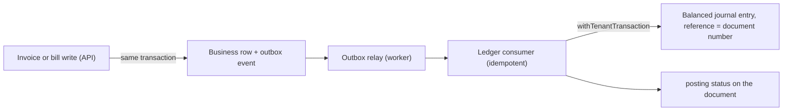

# B7 design: invoices, bills and payments post to the ledger

Status: **decided 2026-11-23, build in stages.** The owner's decisions are in section 5. Stage 1 (schema, posting builder, ledger consumer for issued invoices and full payments, interim guards) is built; stage 2 (edits with reversal and repost, void, partial payments, bills, account fields in the master-data API, backfill) is next. Rules involved: architecture rule 3 (events, not direct writes), rule 4 (accounting is the sink), and the conventions on money, corrections and document numbers in [CLAUDE.md](../CLAUDE.md).

## 1. What is true today (verified in code)

| Fact | Where |
|---|---|
| Invoices and bills created through `/v1/invoicing/*` are stored in `invoices` and `bills` only. Nothing is posted to the ledger and no outbox event is written. | `backend/packages/db/src/invoicing-store.ts`, `apps/api/src/invoicing-routes.ts` |
| `SalesInvoicing` (issue, payment, void by reversal) exists with tests, but is in memory and no API route uses it. | `backend/packages/sales/src/invoicing.ts` |
| `POST /v1/invoicing/invoices/{id}/pay` sets `status = paid`, `balance_due = 0` and nothing else. Partial payments do not exist. | `markInvoicePaid` |
| `DELETE /v1/invoicing/invoices/{id}` is a hard delete. `PUT` can change totals and status freely at any time. | `deleteInvoice`, `updateInvoice` |
| The dashboard, trial balance and quick entries read the ledger only. So a customer invoice made on the invoices screen does not appear in receivables, income or the dashboard; a quick entry does. | `workspace.ts`, `ledger-routes.ts` |
| Quick entries already fix the starter mappings: sale on credit debits 1200 (customers owe you) and credits 4000 (sales); customer payment debits 1000 or 1100 and credits 1200; expense as a bill debits 6900 and credits 2000; tax payable is 2100. | `workspace.ts` `STARTER_ACCOUNTS`, `postEntry` |
| The worker already relays the outbox to BullMQ and has an events consumer slot "ledger posting" that is empty. | `apps/worker/src/main.ts` |

Effect: the two halves of the product disagree. The invoice list can show 10,000 receivable while the ledger shows none, and the books can be edited after the fact. Both break "accounting is the sink" and "never update or delete ledger rows".

## 2. Proposed flow

1. The API writes the document and appends one event to the outbox in the same transaction: `sales.invoice.issued`, `sales.invoice.paid`, `sales.invoice.voided`, `purchasing.bill.approved`, `purchasing.bill.paid`.
2. The worker consumes it in a tenant transaction, posts a balanced entry through `Ledger.post`, with the document number as the reference (retry-safe by design), and records the consumer in the processed-events store so a redelivery does nothing.
3. Each document gets `ledger_entry_id` and `posting_status` (`PENDING`, `POSTED`, `FAILED` with the reason). A failed posting is visible, never silent; the screen shows "not yet in your books".
4. Corrections are reversals: voiding or cancelling a posted document posts a reversal entry (`Ledger.reverse`), never an edit or delete.

## 3. Postings (defaults from the starter chart, base currency only in slice 1)

| Event | Debit | Credit |
|---|---|---|
| Invoice issued, net `N`, tax `T` | 1200 customers owe you, `N + T` | 4000 sales `N`; 2100 tax payable `T` |
| Invoice payment `P` | bank 1100 or cash 1000, `P` | 1200 customers owe you, `P` |
| Invoice voided | reversal of the issue entry (and of payments, refused while payments exist) | |
| Bill approved, net `N`, tax `T` | 6900 other expenses `N`; tax recoverable (see questions) `T` | 2000 you owe suppliers, `N + T` |
| Bill payment `P` | 2000 you owe suppliers `P` | bank 1100 or cash 1000 `P` |

Amounts come from the stored decimal strings through `Money.fromDecimal`, never floats. A document whose lines do not sum to its total is refused before the event is written (balance tests required).

## 4. What changes for the API and frontend

- Invoice update is refused (409) on money fields once the invoice is issued; to change it, void and reissue.
- Invoice delete is allowed only for `draft`; otherwise use void.
- `POST .../pay` takes an optional `amount` and `account` (bank or cash); without them it pays the full balance into the bank account. Partial payment becomes real.
- New `posting_status` and `ledger_entry_id` on invoice and bill responses, in `openapi.yaml`. Antigravity shows the status chip and the "not yet in your books" state.
- Dashboard numbers start to include invoices; existing tenants have invoices that were never posted, so a one-off, reviewed backfill is needed (section 5, question 5).

## 5. Decisions (owner, 2026-11-23)

| # | Question | Decision | Consequence |
|---|---|---|---|
| 1 | When does an invoice hit the books | **On issue.** A `draft` posts nothing | Status `issued`, `sent`, `partially_paid`, `overdue` posts; moving out of `draft` posts |
| 2 | Edit or delete after posting | **Allowed, with automatic reversal and repost** | An edit to money fields reverses the posted entry and posts a new one under a versioned reference (`INV-1`, `INV-1/R1`, ...); a delete or void reverses and keeps the document as `void`. Never an edit of ledger rows |
| 3 | Accounts | **Per item and per party now** | Items carry `revenue_account` and `expense_account`; parties carry `receivable_account` and `payable_account`. Unset falls back to the starter chart (4000, 6900, 1200, 2000). Tax goes to 2100 |
| 4 | Payment account | Bank 1100 by default, cash 1000 optional per payment | Not asked separately; follows the recommendation |
| 5 | Existing documents | **Reviewed backfill, dry run first** | A script lists what it would post per tenant; nothing posts until the output is reviewed |
| 6 | Tax on bills | Still open; slice for bills waits for it | Bills are stage 2 |

Consequence of decision 2: editing an issued invoice is allowed but is not free. Each edit leaves a reversal and a repost in the ledger and in the audit log, which is exactly what an accountant would see after a manual correction.

## 6. Build order once decided

1. Migration: `posting_status`, `ledger_entry_id`, `voided_at` on invoices and bills; outbox events on issue, pay and void. Balance tests for every posting, including half-cent, zero-decimal currency and negative-amount rejection.
2. Ledger consumer in the worker with the processed-events store; Postgres integration test that the entry is balanced, numbered by the invoice number and posted once on redelivery.
3. API changes in section 4 with contract entries; permission checks stay as they are.
4. Backfill script (if chosen), dry run first.
5. Frontend: status chip, void action, partial payment form (Antigravity).

Not in slice 1: multi-currency invoices (needs the FX rate at the invoice date), credit notes, stock postings (INV), payroll.

## 7. Stage 1 as built, and what it does not do yet

- Issuing posts DR receivable (party account or 1200), CR income (item account or 4000), CR 2100 tax payable. Payment posts DR 1100, CR receivable, once per invoice (`INV-1/PAY/1`). A failed posting is stored on the invoice, not lost.
- **Interim guard** (replaced in stage 2): an invoice that is in the books refuses changes to amounts, customer, issue date and status (409) and refuses delete, so the invoice and the ledger cannot drift. This is stricter than the decision (edit with auto reversal) and is temporary.
- Invoices created already paid or partially paid, and invoices in a foreign currency, are not posted automatically (foreign currency is marked FAILED with the reason); they wait for stage 2 and the backfill.
- The new account columns on items and parties are read by the consumer but cannot be set through the API yet.
- Only `sales.invoice.issued` and `sales.invoice.paid` exist. Bills have the columns but no events.
